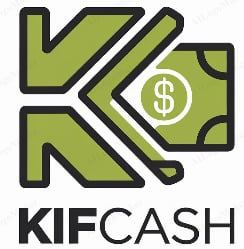

# KifCash Agent Dashboard

<p align="center">
  
</p>

A modern, responsive financial agent dashboard for the KifCash platform. This dashboard enables agents to manage user accounts, process money deposits, track transactions, and analyze performance metrics.

## Features

- **Modern UI**: Clean, intuitive interface with responsive design for all device sizes
- **User Management**: Create and manage user accounts with identity verification
- **Transaction Processing**: Process money deposits with real-time validation
- **Transaction History**: View and filter detailed transaction records
- **User Directory**: Browse and manage user profiles with quick actions
- **Analytics Dashboard**: Visualize transaction data, user activity, and performance metrics
- **Branded Experience**: Consistent branding throughout the application

## Technologies Used

- **Next.js**: React framework for building the application
- **TypeScript**: For type-safe code
- **Tailwind CSS**: For styling and responsive design
- **Shadcn UI**: Component library for consistent UI elements
- **Recharts**: For data visualization
- **Lucide React**: For icons

## Getting Started

### Prerequisites

- Node.js 18.x or higher
- npm or yarn

### Installation

1. Clone the repository:
   ```bash
   git clone https://github.com/yourusername/kifcash-dashboard.git
   cd kifcash-dashboard
